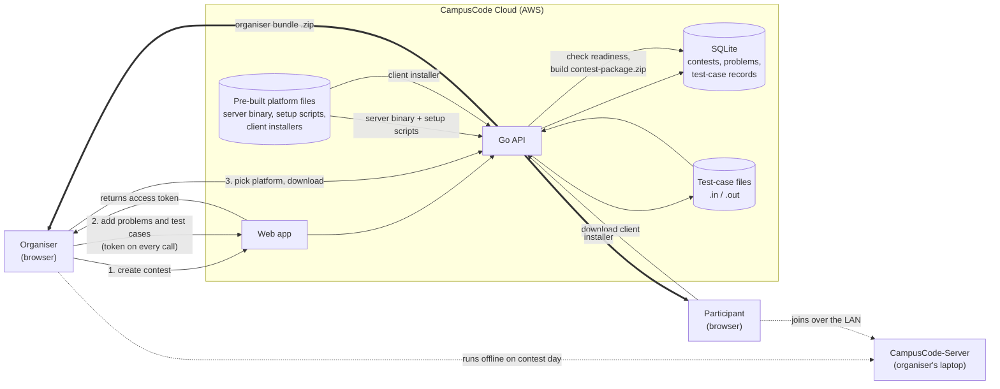

# CampusCode Cloud

The contest-authoring web app for [CampusCode](#part-of-campuscode). Organisers use it, while they're still online, to create a contest, write its problems and test cases, and download a ready-to-run bundle for the offline contest server. Participants use it to download the CampusCode client app.

Nothing is judged here. Cloud only prepares the contest. The contest itself runs offline on the organiser's laptop.

## Part of CampusCode

| Repo | What it does |
|---|---|
| **CampusCode-Cloud** (this repo) | Author a contest and export it as a package |
| [CampusCode-Server](../CampusCode-Server) | Runs the contest offline on the organiser's laptop: judging, scoreboard, admin dashboard |
| [CampusCode-Client](../CampusCode-Client) | The participant app (Electron) |

## What it does

- **Create a contest.** Set a name, a duration, and the admin username and password the organiser will use to log in to the contest server on the day.
- **Add problems.** Each problem has a title, a time limit, a memory limit, and a statement written in Markdown with a live preview.
- **Add test cases.** Upload `.in` / `.out` file pairs, or type them in by hand. Problems can be edited and deleted later.
- **Check readiness.** Before anything is generated, a checklist confirms the contest has a name, duration and admin credentials, and that every problem has a title, valid limits, a statement and at least one test case. The server checks again on download.
- **Download an organiser bundle** for Windows, macOS (Intel) or macOS (Apple Silicon). It is a single zip containing:
  - `contest-package.zip`: `manifest.json`, plus each problem's `meta.json`, `statement.md` and `tests/`
  - the CampusCode-Server binary for that platform
  - the Docker setup script and a short README for the platform
- **Download the participant app.** A public page serves the client installer for each platform, with no contest or token needed.

Problems and test cases are renumbered from 1 in the package, whatever their database IDs are in Cloud. That's what the contest server expects.

## How it works



Organiser actions are scoped to one contest by the access token issued at creation. Downloading the participant app needs no token. The organiser bundle is assembled on demand and streamed to the browser, and the contest package inside it is renumbered from problem 1 to match what the contest server expects.

## Using it

**Hosted app: <http://65.0.183.82:8081>**

Everything is done on the hosted app. There is nothing to install to create a contest or to download the apps.

1. Open the app and choose **Create a Contest**.
2. Fill in the contest details. You get an access token for the contest, which the browser keeps in `localStorage`. There are no user accounts, and that token is what proves you own the contest, so don't clear your browser data mid-setup.
3. Add your problems and test cases.
4. On the last screen, pick the organiser's platform and download the bundle.
5. Unzip the bundle on the organiser's laptop and follow [Setting up the organiser's laptop](#setting-up-the-organisers-laptop) below.

## Setting up the organiser's laptop

The bundle you download is pre-built for your platform, so there is nothing to compile or configure. It has two scripts and the server, and each bundle also carries a short `README.txt` with the same steps.

| File | Windows | macOS (Intel and Apple Silicon) |
|---|---|---|
| Contest data | `contest-package.zip` | `contest-package.zip` |
| Server | `campuscode-server.exe` | `campuscode-server` |
| One-time setup | `setup.bat` | `setup.sh` |
| Contest-day launcher | run the `.exe` directly | `launch.command` |

**1. Run the setup script once, before contest day, with internet.** Double-click `setup.bat` (Windows) or `setup.sh` (macOS). It checks that [Docker Desktop](https://www.docker.com/products/docker-desktop/) is installed and running, then pulls the three images the judge uses to compile and run code:

- `gcc:14` for C++
- `python:3.12-slim` for Python
- `eclipse-temurin:21-jdk` for Java

If Docker isn't installed or isn't running, the script says so, prints what to do, and stops. Install or start Docker Desktop and run it again. If a pull fails, it tells you to check your connection and re-run it. When it reports that all images are ready, this laptop never needs the internet again. On macOS the script also clears the "unidentified developer" flag from the server and launcher.

**2. On contest day, start the server. No internet needed.**

- **macOS:** double-click `launch.command`. It makes the server executable and clears the quarantine flag. Then it starts the server in a Terminal window. Leave that window open for the whole contest, because closing it stops the server.
- **Windows:** run `campuscode-server.exe`. The build isn't code-signed, so SmartScreen may show "Windows protected your PC". Click **More info**, then **Run anyway**.

The server unpacks `contest-package.zip` the first time it runs and opens the admin dashboard at `http://localhost:8080` in your browser. If the browser doesn't open, go to that address yourself. The admin username and password are the ones you set when you created the contest.

**3. Participants install the client app ahead of time.** The client isn't in the organiser bundle. Participants get it from the hosted app's **Download Participant App** page. That needs internet, so do it before contest day. On a Mac they open the `.dmg` and drag the app to Applications. The app isn't signed with an Apple Developer certificate, so the first time they should right-click it and choose **Open**, not double-click.

## Maintainers

The hosted app runs as a single Go binary under systemd on an AWS EC2 instance, and pushes to `main` redeploy it through GitHub Actions ([.github/workflows/deploy.yml](.github/workflows/deploy.yml)). Instance setup, the systemd unit and persistence notes are in [deploy/README.md](deploy/README.md).

## Project layout

```
client/                React + Vite frontend (builds into server/web/dist)
  src/pages/           Landing, CreateContest, AddProblems, GeneratePackage, DownloadClient
server/                Go API (net/http, GORM, SQLite), embeds the built frontend
  handlers/            contest, problem, package/bundle and client-download handlers
  models/              Contest, Problem, TestCase
  storage/             test case file handling
  data/                SQLite database, uploaded test cases, platform bundles
deploy/                build script and systemd unit
```

## Known limitations

- **No user accounts.** Contest access is a bearer token issued at creation. Lose it and you lose the contest, and anyone who has it can edit or delete it. `POST /contests` itself is open to anyone who can reach the server.
- **The admin password is stored in plain text.** The contest server compares it literally against what the admin types, so it can't be hashed.
- **The hosted app is served over plain HTTP.** The contest admin password you enter is sent unencrypted, so choose one you don't reuse elsewhere.
- **The contest duration is recorded, not enforced.** The contest server takes its duration from what the admin enters when pressing Start on contest day.
